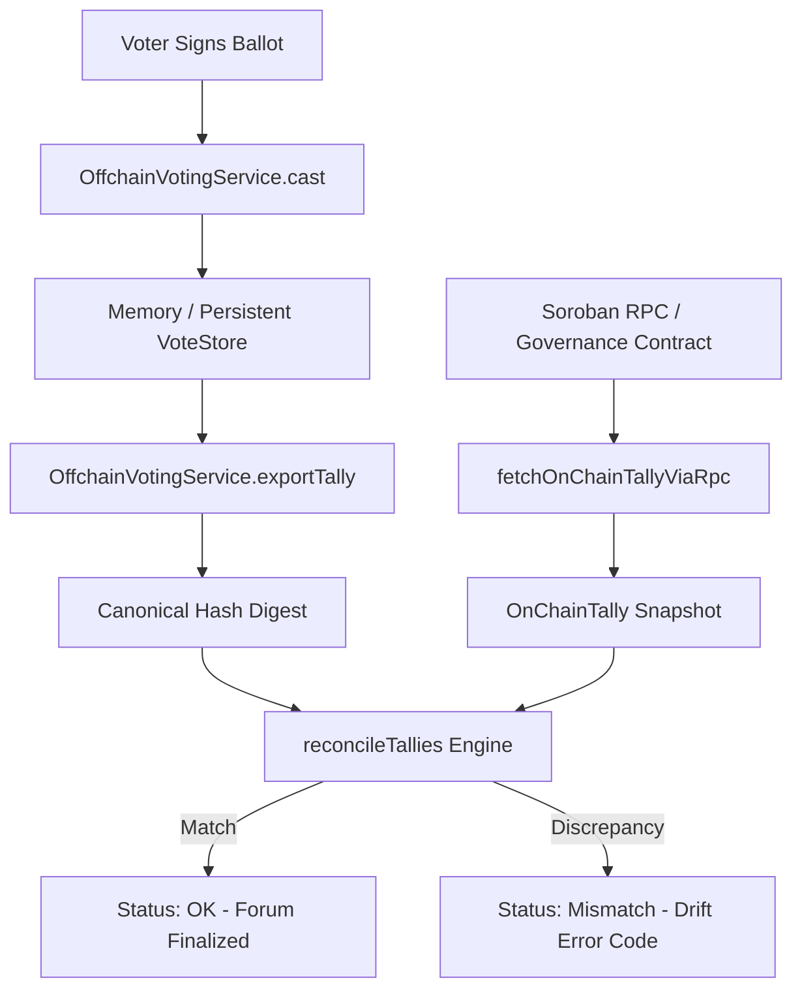

# @kora/offchain-voting

High-integrity off-chain ballot collection, cryptographic tallying, and on-chain governance reconciliation service for the Kora Protocol.

## Overview

The `offchain-voting` package provides gasless, signature-based voting for Kora governance proposals while strictly guaranteeing alignment with on-chain state from `governance_voting`. It prevents drift, detects late or invalid ballots, and verifies consensus before forum discussions or results are finalized.

---

## Architecture & Reconciliation Flow



### Reconciliation Workflow

1. **Ballot Ingestion**: Voters sign structured messages `KORA_OFFCHAIN_VOTE_V1\n{chainId}\n{proposalId}\n{voter}\n{choice}` using Ed25519 keypairs.
2. **On-Chain Reading**: Queries `governance_voting` on Soroban testnet/mainnet via read-only simulation (`get_proposal(u64)`).
3. **Pure Reconciliation**: `reconcileTallies` compares vote totals (`for`, `against`, `total`), quorum satisfaction, voting mode invariants, and canonical SHA-256 summaries.
4. **Execution / Anchoring**: Once verified without drift, `finalize` calls `anchorResult(proposalId, summaryHash, summary)` and optionally triggers on-chain proposal execution.

---

## Trust Assumptions

1. **Cryptographic Identity Authority**:
   - Each ballot must carry a valid Ed25519 signature from the voter's public address matching the designated chain ID and proposal ID.
   - Private key material is never held, requested, or logged by this service.
2. **On-Chain State as Source of Truth**:
   - Voting weight is determined by on-chain stake or token delegation rules.
   - A proposal cannot be simultaneously open for active on-chain voting and off-chain collection (`reserveMode` mutual exclusion).
3. **Temporal Invariants**:
   - Ballots are strictly bounded by `votingEndsAt` and the on-chain `expires_at` timestamp.
   - Any off-chain vote timestamped past the on-chain deadline triggers `OFFCHAIN_AFTER_DEADLINE`.
4. **Deterministic Canonical Serialization**:
   - Tallies produce a deterministic digest using `${proposalId}:${for}:${against}:${total}:${passed}` hashed with SHA-256.
   - Any alteration in tallies or proposal metadata invalidates the digest (`HASH_MISMATCH`).

---

## Reconciliation Status & Error Codes

When executing `reconcile(proposalId)` or `reconcileTallies(offchain, onchain)`, the engine produces an explicit report:

| Code | Status | Description |
| :--- | :---: | :--- |
| `undefined` | `ok` | Off-chain ballots and on-chain vote counts match with identical outcomes and digests. |
| `PROPOSAL_NOT_FOUND` | `mismatch` | Target proposal does not exist in on-chain storage. |
| `TALLY_MISMATCH` | `mismatch` | Vote count difference between off-chain aggregate and on-chain tally (`diffFor`, `diffAgainst`, `diffTotal`). |
| `OUTCOME_MISMATCH` | `mismatch` | Off-chain and on-chain states disagree on whether the proposal passed. |
| `HASH_MISMATCH` | `mismatch` | Discrepancy between off-chain aggregate digest and anchored on-chain result hash. |
| `PARTIAL_QUORUM_UNMET` | `mismatch` | On-chain total votes failed to reach `quorum_required` while off-chain expected a passed proposal. |
| `OFFCHAIN_AFTER_DEADLINE` | `mismatch` | Ballots were accepted or recorded after the on-chain voting deadline expired. |
| `WEIGHT_MODE_MISMATCH` | `mismatch` | Conflict in voting scheme (e.g., standard stake-weighted vs. quadratic or 1-person-1-vote). |

---

## Testing & Verification

Run tests with full coverage:

```bash
npm test
```

Build TypeScript definitions:

```bash
npm run build
```
